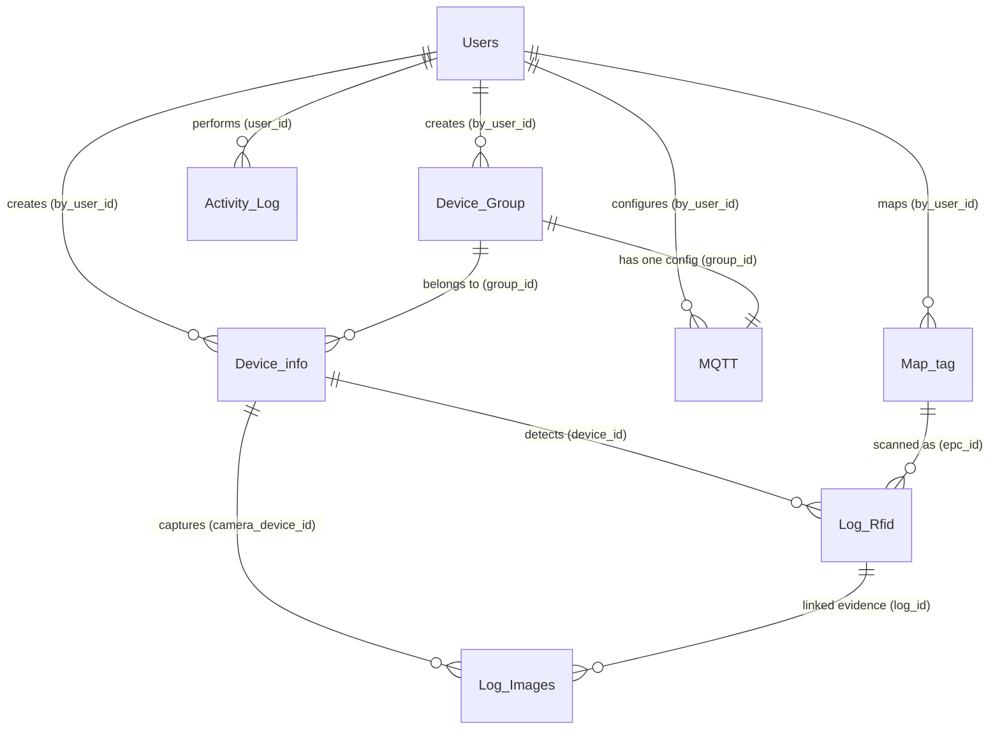

# Database Schema & Data Dictionary

เอกสารอธิบายโครงสร้างฐานข้อมูล (PostgreSQL 15) สำหรับระบบ **IIoT RFID & Camera Management System**

---

## 🗺️ Entity-Relationship Diagram (ERD)

---

## 📊 รายละเอียดตารางทั้งหมด (Data Dictionary)

### 1. `Users` (ตารางผู้ใช้งาน)
เก็บข้อมูลผู้ดูแลระบบ อาจารย์ และนักศึกษา ที่ลงทะเบียนเข้าใช้งานระบบ

| คอลัมน์ | ประเภทข้อมูล | Nullable | ค่าเริ่มต้น | รายละเอียด |
|---|---|---|---|---|
| `user_id` | `INT` | ❌ No | Identity (PK) | รหัสผู้ใช้ (Primary Key) |
| `university_id` | `VARCHAR(20)` | ❌ No | - | รหัสนักศึกษา/อาจารย์ (Unique) เช่น `67199999` |
| `password` | `VARCHAR(255)` | ❌ No | - | รหัสผ่านบัญชี |
| `first_name` | `VARCHAR(255)` | ❌ No | - | ชื่อจริง |
| `last_name` | `VARCHAR(255)` | ❌ No | - | นามสกุล |
| `role` | `VARCHAR(20)` | ❌ No | `'student'` | สิทธิ์การใช้งาน (`student`, `teacher`, `admin`, `dev`, `staff`) |
| `created_at` | `TIMESTAMP(0)` | ❌ No | `CURRENT_TIMESTAMP` | วันที่สร้างบัญชี |
| `last_login_at` | `TIMESTAMP(0)` | ❌ No | `CURRENT_TIMESTAMP` | เวลาที่เข้าสู่ระบบล่าสุด |
| `is_delete` | `BOOLEAN` | ❌ No | `FALSE` | Soft Delete (ระงับบัญชี) |
| `token` | `VARCHAR(255)` | ⭕ Yes | - | JWT Token ปัจจุบัน (Unique) |

---

### 2. `Device_Group` (ตารางกลุ่มอุปกรณ์)
จัดกลุ่มอุปกรณ์ IoT (เช่น ประตูห้อง 101, ประตูทางเข้าอาคาร 5) เพื่อผูกอุปกรณ์ RFID, กล้อง CAM, และ Topic MQTT เข้าด้วยกัน

| คอลัมน์ | ประเภทข้อมูล | Nullable | ค่าเริ่มต้น | รายละเอียด |
|---|---|---|---|---|
| `group_id` | `INT` | ❌ No | Identity (PK) | รหัสกลุ่มอุปกรณ์ (Primary Key) |
| `group_name` | `VARCHAR(50)` | ❌ No | - | ชื่อกลุ่ม (Unique) เช่น `ROOM_TEST_101` |
| `by_user_id` | `INT` | ❌ No | - | Foreign Key $\rightarrow$ `Users(user_id)` |
| `created_at` | `TIMESTAMP(0)` | ❌ No | `CURRENT_TIMESTAMP` | วันที่สร้างกลุ่ม |
| `is_delete` | `BOOLEAN` | ❌ No | `FALSE` | Soft Delete |

---

### 3. `Device_info` (ตารางข้อมูลอุปกรณ์ IoT)
เก็บข้อมูลฮาร์ดแวร์บอร์ด ESP32 RFID และ ESP32-S3 Camera

| คอลัมน์ | ประเภทข้อมูล | Nullable | ค่าเริ่มต้น | รายละเอียด |
|---|---|---|---|---|
| `device_id` | `INT` | ❌ No | Identity (PK) | รหัสอุปกรณ์ (Primary Key) |
| `device_name` | `VARCHAR(100)` | ⭕ Yes | - | ชื่อเรียกอุปกรณ์ เช่น `RFID_Reader_1` |
| `device_type` | `VARCHAR(20)` | ❌ No | - | ชนิดอุปกรณ์: `'RFID'` หรือ `'CAM'` |
| `group_id` | `INT` | ❌ No | - | Foreign Key $\rightarrow$ `Device_Group(group_id)` (Cascade Delete) |
| `by_user_id` | `INT` | ⭕ Yes | - | Foreign Key $\rightarrow$ `Users(user_id)` ผู้ลงทะเบียนอุปกรณ์ |
| `mac` | `VARCHAR(17)` | ❌ No | - | MAC Address **(ไม่มีเครื่องหมาย `:` เช่น `246F28ABCDEF`)** (Unique) |
| `ip` | `VARCHAR(45)` | ❌ No | `'127.0.0.1'` | IP Address ของอุปกรณ์ |
| `subnet` | `VARCHAR(45)` | ❌ No | `'255.255.255.0'` | Subnet Mask |
| `gate_way` | `VARCHAR(45)` | ❌ No | `'127.0.0.1'` | Gateway IP |
| `last_active_at` | `TIMESTAMP(0)` | ⭕ Yes | `CURRENT_TIMESTAMP` | เวลา Heartbeat/ส่งข้อมูลล่าสุด |
| `hw_uptime` | `INT` | ❌ No | `0` | ค่า Uptime ที่เครื่องส่งขึ้นมา (`millis()`) |
| `local` | `VARCHAR(255)` | ❌ No | - | ตำแหน่งติดตั้ง เช่น `Building 5 Floor 9` |
| `created_at` | `TIMESTAMP(0)` | ❌ No | `CURRENT_TIMESTAMP` | วันที่ลงทะเบียน |
| `is_delete` | `BOOLEAN` | ❌ No | `FALSE` | Soft Delete |
| `status` | `BOOLEAN` | ❌ No | `FALSE` | สถานะการทำงาน (`true` = Online, `false` = Offline) |
| `key_api` | `VARCHAR(255)` | ❌ No | - | Secret Key ประจำตัวอุปกรณ์สำหรับใช้ยืนยันตัวตน (Unique) |

---

### 4. `MQTT` (ตารางการตั้งค่า MQTT Broker/Topic)
การตั้งค่าเชื่อมต่อ MQTT ประจำแต่ละกลุ่มอุปกรณ์ (ความสัมพันธ์แบบ 1 กลุ่ม ต่อ 1 การตั้งค่า MQTT)

| คอลัมน์ | ประเภทข้อมูล | Nullable | ค่าเริ่มต้น | รายละเอียด |
|---|---|---|---|---|
| `mqtt_id` | `INT` | ❌ No | Identity (PK) | รหัสการตั้งค่า (Primary Key) |
| `by_user_id` | `INT` | ❌ No | - | Foreign Key $\rightarrow$ `Users(user_id)` ผู้ตั้งค่า |
| `group_id` | `INT` | ❌ No | - | Foreign Key $\rightarrow$ `Device_Group(group_id)` (Unique, Cascade Delete) |
| `topic` | `VARCHAR(255)` | ⭕ Yes | - | ชื่อ Topic หลัก เช่น `door_test_101` |
| `user_mqtt` | `VARCHAR(255)` | ⭕ Yes | - | Username สำหรับต่อ MQTT Broker |
| `pass_mqtt` | `VARCHAR(255)` | ⭕ Yes | - | Password สำหรับต่อ MQTT Broker |
| `created_at` | `TIMESTAMP(0)` | ❌ No | `CURRENT_TIMESTAMP` | วันที่บันทึก |
| `is_delete` | `BOOLEAN` | ❌ No | `FALSE` | Soft Delete |

---

### 5. `Map_tag` (ตารางจับคู่แท็ก RFID)
บันทึกรหัส EPC ของแท็ก RFID และผูกเข้ากับชื่อหรือผู้ใช้งาน

| คอลัมน์ | ประเภทข้อมูล | Nullable | ค่าเริ่มต้น | รายละเอียด |
|---|---|---|---|---|
| `epc_id` | `INT` | ❌ No | Identity (PK) | รหัสบันทึกแท็ก (Primary Key) |
| `epc` | `VARCHAR(255)` | ❌ No | - | รหัสบัตร RFID EPC (Unique) |
| `tag` | `VARCHAR(255)` | ⭕ Yes | - | ป้ายกำกับ/ชื่อ เช่น `บัตรนักศึกษา สมชาย` |
| `by_user_id` | `INT` | ⭕ Yes | - | Foreign Key $\rightarrow$ `Users(user_id)` ผู้ถือบัตร |
| `status` | `VARCHAR(20)` | ⭕ Yes | `'pending'` | สถานะแท็ก: `'pending'`, `'active'`, `'stolen'` |
| `created_at` | `TIMESTAMP(0)` | ❌ No | `CURRENT_TIMESTAMP` | วันที่ลงทะเบียนแท็ก |
| `is_delete` | `BOOLEAN` | ❌ No | `FALSE` | Soft Delete |

---

### 6. `Log_Rfid` (ตารางประวัติการแตะบัตร RFID)
บันทึกประวัติการตรวจจับแท็ก RFID จากเครื่องอ่าน

| คอลัมน์ | ประเภทข้อมูล | Nullable | ค่าเริ่มต้น | รายละเอียด |
|---|---|---|---|---|
| `log_id` | `INT` | ❌ No | Identity (PK) | รหัส Log การอ่าน (Primary Key) |
| `device_id` | `INT` | ❌ No | - | Foreign Key $\rightarrow$ `Device_info(device_id)` เครื่องที่อ่านได้ |
| `epc_id` | `INT` | ❌ No | - | Foreign Key $\rightarrow$ `Map_tag(epc_id)` แท็กที่ถูกอ่าน |
| `distance` | `DOUBLE PRECISION` | ⭕ Yes | - | ค่าระยะห่าง หรือ RSSI สัญญาณที่อ่านได้ |
| `time_stamp` | `TIMESTAMP(0)` | ❌ No | `CURRENT_TIMESTAMP` | เวลาที่สแกนบัตร |

---

### 7. `Log_Images` (ตารางภาพหลักฐานจากกล้อง)
เก็บเส้นทาง Path รูปภาพที่กล้อง ESP32-S3 ถ่ายภาพไว้เมื่อมีการสแกน RFID

| คอลัมน์ | ประเภทข้อมูล | Nullable | ค่าเริ่มต้น | รายละเอียด |
|---|---|---|---|---|
| `image_id` | `INT` | ❌ No | Identity (PK) | รหัสภาพ (Primary Key) |
| `log_id` | `INT` | ❌ No | - | Foreign Key $\rightarrow$ `Log_Rfid(log_id)` (Cascade Delete) |
| `camera_device_id` | `INT` | ❌ No | - | Foreign Key $\rightarrow$ `Device_info(device_id)` กล้องที่ถ่ายภาพ |
| `image_path` | `VARCHAR(500)` | ❌ No | - | URL Path เก็บรูปภาพ เช่น `/uploads/img-...jpg` |
| `created_at` | `TIMESTAMP(0)` | ❌ No | `CURRENT_TIMESTAMP` | เวลาที่บันทึกรูป |

---

### 8. `Activity_Log` (ตาราง Audit Log ระบบ)
เก็บบันทึกการกระทำทุกอย่างในระบบ (Audit Trail) ผ่าน JSONB Payload

| คอลัมน์ | ประเภทข้อมูล | Nullable | ค่าเริ่มต้น | รายละเอียด |
|---|---|---|---|---|
| `activity_id` | `BIGINT` | ❌ No | Identity (PK) | รหัสบันทึกกิจกรรม (Primary Key) |
| `user_id` | `INT` | ⭕ Yes | - | Foreign Key $\rightarrow$ `Users(user_id)` (Set Null on Delete) |
| `action_type` | `VARCHAR(100)` | ❌ No | - | กิจกรรม เช่น `LOGIN`, `SIGIN`, `LOGOUT`, `INSERT`, `UPDATE`, `DELETE` |
| `target_table` | `VARCHAR(100)` | ⭕ Yes | - | ตารางที่ถูกกระทำ เช่น `Users`, `device_info`, `mqtt` |
| `target_id` | `INT` | ⭕ Yes | - | Primary Key ของแถวในตารางที่ถูกกระทำ |
| `payload` | `JSONB` | ⭕ Yes | - | ข้อมูลที่เกี่ยวข้องแบบ JSON (มี Index GIN) |
| `time_action` | `TIMESTAMP(0)` | ❌ No | `CURRENT_TIMESTAMP` | เวลาที่เกิดเหตุการณ์ (มี B-Tree Index DESC) |
