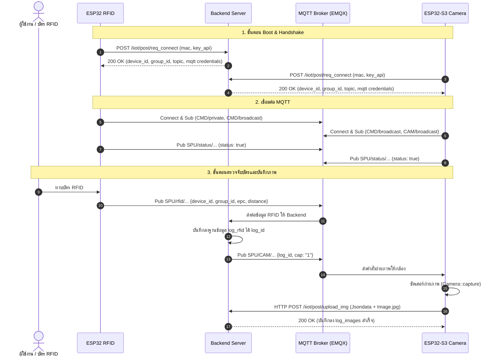

# Hardware Integration & Lifecycle Guide

คู่มือกระบวนการทำงานของฮาร์ดแวร์ **ESP32 RFID Reader**, **ESP32-S3 Camera** และแนวทางการประยุกต์ใช้กับกล้องหรือบอร์ดรุ่นอื่นในอนาคต

---

## 🧭 แผนผังภาพรวมการทำงาน (System Sequence Diagram)



---

## 🔄 วงจรชีวิตของอุปกรณ์ (Device Lifecycle Phases)

### 📌 เฟส 1: เริ่มต้นระบบและการเชื่อมต่อเครือข่าย (Boot & Network)
1. **Init Hardware:** เริ่มต้น Serial Monitor (115200), จอแสดงผล OLED (I2C) และ Rotary Encoder
2. **Init Storage:** เริ่มต้น NVS Flash และ LittleFS/EEPROM
3. **ตรวจสอบ WiFi Config:**
   - ตรวจหา SSID และ Password ที่บันทึกไว้ในความจำ
   - **กรณีไม่มีข้อมูล:** เปิดโหมด SoftAP (Captive Portal) เพื่อให้ผู้ใช้เชื่อมต่อผ่านมือถือและกรอก WiFi
   - **กรณีมีข้อมูล:** เชื่อมต่อ WiFi Station ทันที
4. **ซิงค์เวลา:** ซิงค์เวลาโลกผ่าน NTP Server (`pool.ntp.org`, Timezone UTC+7)

---

### 📌 เฟส 2: การตรวจสอบสิทธิ์กับเซิร์ฟเวอร์ (Server Handshake)
อุปกรณ์จะไม่เก็บการตั้งค่า MQTT แบบคงที่ไว้ในตัวบอร์ด แต่จะร้องขอการตั้งค่าล่าสุดจาก Backend เสมอ:

1. ดึง MAC Address ของชิป WiFi และ **ตัดเครื่องหมาย `:` ออก** เช่น `246F28ABCDEF`
2. ส่งคำสั่ง HTTP POST ไปที่:
   ```http
   POST /iiot/post/req_connect HTTP/1.1
   Host: <SERVER_IP>:3000
   Authorization: <key_api>
   Content-Type: application/json

   { "mac": "246F28ABCDEF" }
   ```
3. Backend จะตรวจสอบ `key_api` และ `mac` ในฐานข้อมูล `device_info` และ `mqtt`
4. Backend ส่งข้อมูลกลับมา:
   - `device_id` และ `group_id`
   - `topic`: Topic หลักประจำกลุ่ม (เช่น `door_test_101`)
   - `user_mqtt` และ `pass_mqtt`

---

### 📌 เฟส 3: การเชื่อมต่อ MQTT Broker
เมื่อได้ข้อมูลจากการ Handshake แล้ว อุปกรณ์จะประกอบ Topic และเชื่อมต่อ Broker:

1. **ประกอบ Topic ตามโครงสร้าง:**
   - Private CMD: `SPU/CMD/group{group_id}/{topic}/{mac}`
   - Broadcast CMD: `SPU/CMD/group{group_id}/{topic}/broadcast`
   - Status Pub: `SPU/status/group{group_id}/{topic}/{mac}`
   - RFID Pub: `SPU/rfid/group{group_id}/{topic}/{mac}` (เฉพาะเครื่อง RFID)
   - CAM Sub: `SPU/CAM/group{group_id}/{topic}/broadcast` (เฉพาะเครื่องกล้อง)
2. **ตั้งค่า Last Will and Testament (LWT):**
   - Topic: `SPU/status/group{group_id}/{topic}/{mac}`
   - Payload: `{"status": false, "device_id": <id>, "mac": "<mac>"}` (Retain: true)
3. **Subscribe Topics:**
   - บอร์ด RFID จะ Subscribe ช่อง CMD
   - บอร์ดกล้องจะ Subscribe ช่อง CMD และช่อง CAM
4. **ส่ง Heartbeat แรก:** ส่ง `{ "status": true, ... }` ขึ้น Broker ทันที

---

### 📌 เฟส 4: ลูปการทำงานปกติ (Runtime Operation)

#### 🏷️ ฝั่ง ESP32 RFID Reader:
- อ่านข้อมูลแท็ก RFID ผ่านพอร์ต UART2 (`Serial2` Pins: Rx=15, Tx=16)
- เมื่อได้รับ Frame ข้อมูลที่ถูกต้อง จะถอดรหัสออกมาเป็นรหัส EPC และค่า Distance
- ยิง Payload ไปยัง Topic `SPU/rfid/...`:
  ```json
  {
    "device_id": 8,
    "group_id": 7,
    "epc": "E280116060000215467151CC",
    "distance": 2.5
  }
  ```
- ทุกๆ 30 วินาที ส่ง Heartbeat Health Monitor (Free Heap, WiFi RSSI, Uptime) ขึ้น `SPU/status/...`

#### 📷 ฝั่ง ESP32-S3 Camera:
- รอรับคำสั่งผ่าน MQTT Topic `SPU/CAM/...`
- เมื่อได้รับ `{ "log_id": 105, "cap": "1" }`:
  1. สั่งโมดูลกล้องถ่ายภาพ `Camera::capture()`
  2. โยนงานเข้า FreeRTOS Queue (`ImageQueue`) เพื่อไม่ให้บล็อกฟังก์ชัน Callback ของ MQTT
  3. Worker Task แยกแกน CPU (`uploadTask`) ดึงภาพจากคิว และส่ง HTTP POST Multipart ไปที่ `/iiot/post/upload_img`
  4. คืน Memory Frame Buffer (`esp_camera_fb_return`) เพื่อป้องกัน RAM รั่ว

---

## 🔌 การต่อสายขาฮาร์ดแวร์ (Pinout Configuration)

### บอร์ด ESP32 RFID Reader
| อุปกรณ์ / โมดูล | ขาบน ESP32 | หน้าที่ |
|---|---|---|
| **RFID Reader UART** | `GPIO 15` (Rx) | รับข้อมูลบัตรจากโมดูล RFID |
| **RFID Reader UART** | `GPIO 16` (Tx) | ส่งคำสั่งไปโมดูล RFID |
| **OLED Display** | `GPIO 21` (SDA) | สื่อสารจอ I2C Data |
| **OLED Display** | `GPIO 22` (SCL) | สื่อสารจอ I2C Clock |
| **Rotary Encoder** | `GPIO 32` / `33` | อ่านทิศทางการหมุน (A / B) |
| **ปุ่ม Confirm** | `GPIO 25` | ยืนยันการเลือกเมนู |
| **ปุ่ม Back** | `GPIO 26` | ย้อนกลับเมนูก่อนหน้า |

---

## 📷 ข้อกำหนดสำหรับการเปลี่ยนกล้องหรือบอร์ดรุ่นอื่น (Future Compatibility)

หากในอนาคตต้องการเปลี่ยนจาก **ESP32-S3** ไปใช้กล้องแบบอื่น (เช่น **Raspberry Pi Camera**, **IP Camera**, หรือ **บอร์ด ARM/Linux** อื่นๆ) กล้องใหม่เพียงแค่ต้องรองรับเงื่อนไข 2 ข้อนี้ก็สามารถทำงานร่วมกับระบบได้ทันที:

1. **รองรับ MQTT Client:**
   - ต่อ Broker เดียวกัน และ Subscribe Topic:
     `SPU/CAM/group{group_id}/{topic}/broadcast`
   - ดักจับ Message JSON ที่มีฟิลด์ `log_id` และ `cap: "1"`
2. **ส่ง HTTP POST Multipart Form-Data ได้:**
   - เมื่อถ่ายภาพเสร็จ ยิง HTTP Request ไปที่ Backend:
     ```http
     POST /iiot/post/upload_img HTTP/1.1
     Authorization: <key_api>
     Content-Type: multipart/form-data; boundary=----BoundaryXYZ

     ------BoundaryXYZ
     Content-Disposition: form-data; name="Jsondata"
     Content-Type: application/json

     {"log_id": 105, "device_id": 2, "group_id": 7, "mac": "A0B1C2D3E4F5"}
     ------BoundaryXYZ
     Content-Disposition: form-data; name="img"; filename="capture.jpg"
     Content-Type: image/jpeg

     <BINARY_IMAGE_DATA>
     ------BoundaryXYZ--
     ```
